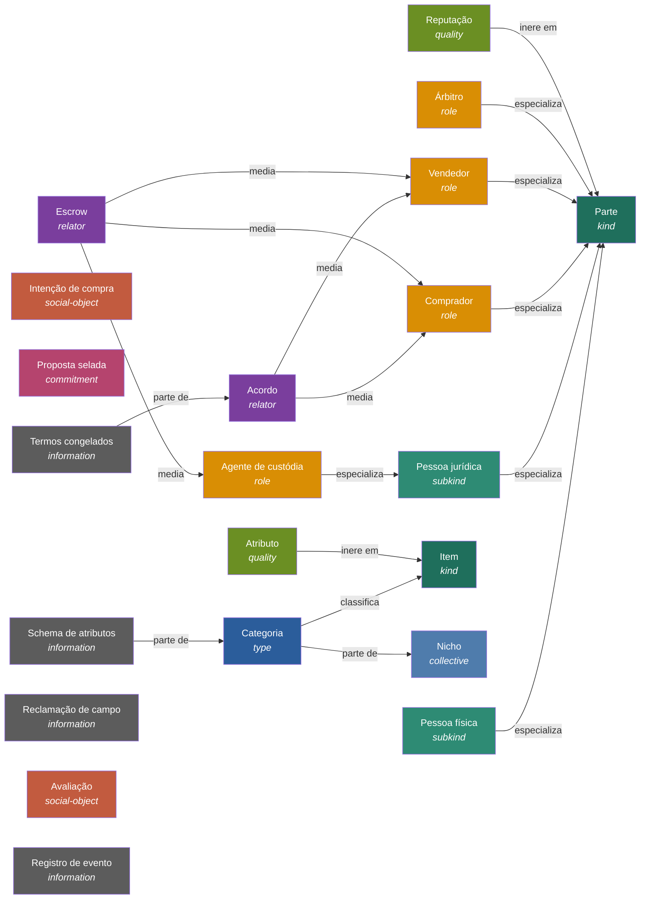

<!-- Gerado por `go run ./cmd/intenza-kb render`. Não edite à mão: edite knowledge/*.yaml. -->

# Base de conhecimento

Três perguntas organizam o Intenza: **o que existe** (ontologia), **como a gente sabe** (epistemologia) e **o que pode dar errado** (riscos). Cada resposta é dado versionado em `knowledge/` e um verificador confere contra o código, os testes e os experimentos de caos.

## Estado epistêmico

A priori vale para toda entrada no escopo (conhecimento determinístico). A posteriori sobreviveu a uma tentativa de refutação no sistema rodando (conhecimento estocástico). Testemunho é emprestado de uma autoridade. Conjectura é dívida.

| base | modo | força | alegações |
|---|---|---:|---:|
| por construção | a priori | 7 | 5 |
| prova exaustiva | a priori | 6 | 4 |
| teste de propriedade | a priori | 5 | 5 |
| teste de exemplo | a priori | 4 | 21 |
| medido | a posteriori | 3 | 0 |
| testemunho | testemunhal | 2 | 3 |
| conjectura | sem justificativa | 1 | 8 |

Dívida epistêmica: **8 de 46** alegações ainda são conjecturas.

## Riscos

Cada risco é uma cadeia causa → mecanismo → efeito. A solução é determinística (remove o modo de falha e se justifica a priori), estocástica (reduz probabilidade ou impacto e só se justifica medindo) ou híbrida (piso determinístico e teto medido).

### Matriz incerteza × solução

| | determinística | estocástica | híbrida |
|---|---|---|---|
| **aleatória** | clock-skew, double-award, double-settlement, duplicate-intent, duplicate-processing, invalid-identifier, late-bid, lost-event | cache-stampede, database-outage, deadline-herd, psp-latency-tail | broker-outage, redis-outage, webhook-loss |
| **epistêmica** | autoparts-regulatory, biased-ranking, bid-leak, forbidden-category, funds-custody, he-said-she-said, retaliation | cold-start-seller | poison-message |

Mitigados com a evidência certa para a natureza da solução: **15 de 24**.

| risco | S×P | causa → mecanismo → efeito | solução | status | mitigado por | experimentos |
|---|---:|---|---|---|---|---|
| **he-said-she-said** Disputa sem base objetiva | 16 | Descrição livre e prova informal. → Ninguém consegue dizer o que foi prometido. → Resolução arbitrária, custo de suporte e reputação injusta. | determinística | mitigado | terms-snapshot-tamper-evident, dispute-is-field-conference |  |
| **duplicate-processing** Evento aplicado duas vezes | 16 | Entrega pelo menos uma vez (retentativa, rebalanceamento, relay que cai antes do checkpoint). → O consumidor reaplica o efeito do mesmo evento. → Reputação contada em dobro, notificação repetida, comando duplicado. | determinística | mitigado | consumers-effectively-once |  |
| **webhook-loss** Webhook do agente de custódia perdido, duplicado ou fora de ordem | 16 | Rede, retentativa do agente ou indisponibilidade da API. → A plataforma não fica sabendo que o dinheiro caiu ou foi liberado. → Acordo preso, vendedor sem enviar, comprador sem resposta. | híbrida | exposto | webhook-handling-idempotent, reconciliation-converges |  |
| **psp-latency-tail** Cauda de latência do agente de custódia | 16 | Agente externo com latência lognormal e picos. → Chamadas presas seguram conexões e goroutines e a fila cresce. → Latência da API sobe para todo mundo, não só para quem paga. | estocástica | exposto | psp-calls-bounded |  |
| **bid-leak** Vazamento de preço selado | 15 | Caminho não previsto expõe o preço (log, evento, dump, consulta ampla, revelação antecipada). → Concorrente ou comprador vê preços antes do fechamento e passa a ancorar ou combinar. → A proposta selada vira leilão aberto disfarçado e os melhores vendedores saem. | determinística | mitigado | sealed-price-encrypted-at-rest, reveal-gated-by-persisted-close, events-carry-no-price |  |
| **double-settlement** Liberação ou estorno disparado duas vezes, ou os dois | 15 | Evento redelivery, webhook duplicado ou retentativa após timeout. → O comando ao agente de custódia é reenviado sem chave ou o estado não é terminal. → Dinheiro liberado e estornado, ou liberado duas vezes. | determinística | mitigado | escrow-command-idempotent, settlement-terminal-exclusive, webhook-handling-idempotent |  |
| **late-bid** Proposta aceita depois do prazo | 12 | Envio e fechamento correm no mesmo instante. → A checagem de prazo e a gravação acontecem em momentos diferentes. → Vendedor que viu o fechamento chegando entra depois e quebra a isonomia. | determinística | mitigado | no-bid-after-close |  |
| **invalid-identifier** Identificador digitado errado vira prova falsa | 12 | Erro de digitação em GTIN, VIN, ISBN ou documento. → O campo probatório guarda um identificador que não existe. → Contrato aponta para outro item ou para ninguém. | determinística | mitigado | identifiers-check-digit-validated |  |
| **lost-event** Evento perdido entre banco e broker | 12 | Escrita dupla em banco e broker sem transação comum. → O processo cai depois de gravar o estado e antes de publicar. → Projeções e sagas nunca ficam sabendo da mudança. | determinística | mitigado | outbox-atomic-with-state |  |
| **duplicate-intent** Retentativa do cliente cria intenção duplicada | 12 | Timeout no cliente depois que o servidor já gravou. → O mesmo pedido chega duas vezes. → Duas intenções iguais e vendedores respondendo em dobro. | determinística | mitigado | intent-creation-idempotent |  |
| **broker-outage** Broker indisponível | 12 | Broker cai, pausa ou perde a rede. → O relay não publica e o outbox acumula. → Projeções e sagas atrasam, mas a escrita continua aceitando. | híbrida | exposto | outbox-atomic-with-state, backlog-drains |  |
| **redis-outage** Redis indisponível | 12 | Redis cai, pausa ou fica lento. → Idempotência rápida, limite de taxa, prazos e cache perdem o apoio. → Duplicata, rajada sem limite ou fechamento atrasado se não houver degradação planejada. | híbrida | exposto | intent-creation-idempotent, deadlines-survive-redis-loss |  |
| **deadline-herd** Rajada de última hora no fechamento | 12 | Vendedores deixam para o fim e muitos prazos vencem juntos. → A taxa de chegada cresce perto do prazo e os fechamentos se acumulam. → Latência sobe exatamente quando importa e propostas perdem o prazo. | estocástica | exposto | rate-limit-protects-p99 |  |
| **cold-start-seller** Vendedor novo nunca vence | 12 | Sem histórico, a reputação é desconhecida. → Ordenação por reputação pontual favorece sempre quem já vende. → Concentração de mercado e oferta estagnada. | estocástica | exposto | reputation-shrinks-small-samples, exploration-exposes-new-sellers |  |
| **double-award** Duas propostas escolhidas para a mesma intenção | 10 | Clique duplo, retentativa do cliente ou duas abas. → Duas seleções leem a intenção aberta e gravam em paralelo. → Dois acordos e dois escrows para um item só. | determinística | mitigado | single-award-per-intent |  |
| **forbidden-category** Anúncio em categoria proibida | 10 | Erro de curadoria ou categoria genérica demais. → Intenção é publicada num nó que admite item proibido. → Venda de arma, medicamento ou animal pela plataforma. | determinística | mitigado | forbidden-categories-unrepresentable |  |
| **autoparts-regulatory** Peça de desmonte sem rastreabilidade ou item de segurança | 10 | Autopeças concentram a maior densidade regulatória. → Vendedor sem credencial ou peça sem etiqueta entra na árvore. → Receptação, risco à segurança viária e sanção. | determinística | mitigado | autoparts-restricted-by-design, identifiers-check-digit-validated, dismantling-law |  |
| **retaliation** Avaliação retaliatória | 9 | Uma parte vê a avaliação da outra antes de avaliar. → Nota baixa provoca nota baixa de volta. → Reputação vira negociação e perde sinal. | determinística | mitigado | ratings-double-blind |  |
| **clock-skew** Relógio de um nó fora do lugar | 8 | NTP falha ou VM pausa e o relógio local adianta ou atrasa. → Decisões de prazo tomadas com o relógio local discordam entre nós. → Proposta aceita depois do prazo ou envelope aberto antes da hora. | determinística | mitigado | reveal-gated-by-persisted-close, effective-status-is-time-function |  |
| **database-outage** Banco indisponível | 8 | Primário pausa, cai ou troca. → Chamadas ficam esperando conexão e acumulam. → A API pendura em vez de falhar rápido. | estocástica | exposto | mongo-outage-fails-fast |  |
| **poison-message** Evento malformado trava o consumidor | 6 | Versão de esquema inesperada ou dado corrompido. → O consumidor falha sempre no mesmo offset. → A partição para e o atraso cresce sem limite. | híbrida | exposto | poison-message-isolated |  |
| **cache-stampede** Estouro de recomputação no cache | 6 | Muitas chaves expiram juntas sob carga. → Todas as réplicas recomputam a mesma coisa ao mesmo tempo. → Pico de carga no banco e latência em degrau. | estocástica | exposto | cache-early-refresh |  |
| **biased-ranking** Ordenação arbitrária ou manipulável | 6 | Critério opaco ou dependente da ordem de chegada. → Duas consultas iguais devolvem ordens diferentes. → Comprador desconfia e vendedor otimiza o horário em vez da oferta. | determinística | mitigado | selection-deterministic-explainable |  |
| **funds-custody** Dinheiro transitando por conta própria | 5 | Atalho de produto para simplificar repasse ou estorno. → A plataforma passa a custodiar recursos de terceiros. → Exposição regulatória e risco de crédito sobre o valor dos clientes. | determinística | mitigado | platform-never-holds-funds, payment-institution-regulated |  |

## Alegações

| alegação | enunciado | tipo | base | evidência |
|---|---|---|---|---|
| **forbidden-categories-unrepresentable** | Categorias proibidas (armas, medicamentos, animais, tabaco, álcool) não existem na árvore, e um identificador de categoria só nasce de um nó dela. | safety | por construção | símbolo `internal/domain/taxonomy.Tree.Lookup` teste `internal/domain/taxonomy.TestForbiddenCategoriesDoNotExist` teste `internal/domain/taxonomy.TestLoaderRefusesForbiddenAnchorsAndTerms` |
| **intent-creation-idempotent** | Repetir a criação de intenção com a mesma Idempotency-Key devolve a mesma intenção, com ou sem Redis. | safety | por construção | símbolo `internal/app.Market.PublishIntent` teste `internal/integration.TestEndToEndMarket` |
| **no-bid-after-close** | Nenhuma proposta é aceita depois do fechamento, nem em corrida com o fechador. | safety | por construção | símbolo `internal/adapter/mongo.guardFilter` teste `internal/domain/intent.TestNoProposalAtOrAfterTheDeadline` teste `internal/integration.TestNoProposalAfterCloseUnderRace` |
| **platform-never-holds-funds** | Nenhum caminho de código leva dinheiro para conta da plataforma. A porta do escrow só abre, libera e estorna. | regulatory | por construção | símbolo `internal/app.Escrow` |
| **reveal-gated-by-persisted-close** | O preço só abre depois que a intenção foi fechada no banco, sob o relógio do banco. Relógio local adiantado não antecipa a revelação. | safety | por construção | símbolo `internal/domain/proposal.Reveal` teste `internal/domain/proposal.TestRevealIgnoresTheLocalClock` |
| **check-digits-catch-single-substitutions** | GTIN, ISBN-10 e VIN detectam toda substituição de um caractere. No VIN, a exceção são letras com a mesma transliteração (A e J valem 1). | integrity | prova exaustiva | teste `standards/gs1/gtin.TestCheckDigitDetectionIsExactlyKnown` teste `standards/iso/iso2108.TestISBN10DetectsEverySubstitutionAndTransposition` teste `standards/iso/iso3779.TestEverySubstitutionChangesTheCheckOrCollidesInTransliteration` |
| **gtin-misses-transpositions-by-five** | O dígito do GTIN não detecta troca de vizinhos que diferem em 5 (05 por 50). O ISBN-10 detecta toda troca de vizinhos. | integrity | prova exaustiva | teste `standards/gs1/gtin.TestCheckDigitDetectionIsExactlyKnown` teste `standards/iso/iso2108.TestISBN10DetectsEverySubstitutionAndTransposition` |
| **phases-match-state-machines** | As fases declaradas na ontologia são exatamente os estados alcançáveis das máquinas de estado, e as fases terminais não têm saída. | integrity | prova exaustiva | teste `internal/domain/intent.TestMachineMatchesTheOntologyPhases` teste `internal/domain/proposal.TestMachineMatchesTheOntologyPhases` teste `internal/domain/agreement.TestSettlementOutcomesAreExclusive` |
| **settlement-terminal-exclusive** | Liberado, estornado e cancelado são terminais e exclusivos. Um acordo nunca libera e estorna. | safety | prova exaustiva | teste `internal/domain/agreement.TestSettlementOutcomesAreExclusive` |
| **cnpj-alphanumeric-extends-legacy** | A regra do CNPJ alfanumérico coincide com a regra numérica antiga em toda base só de dígitos. | integrity | teste de propriedade | teste `standards/rfb/cnpj.TestAlphanumericRuleAgreesWithLegacyOnDigits` |
| **cpf-check-is-imperfect** | O CPF deixa passar cerca de 0,2% das substituições de um dígito, porque os restos 0 e 1 viram o mesmo dígito. | integrity | teste de propriedade | teste `standards/rfb/cpf.TestSingleSubstitutionDetectionRate` |
| **generated-items-satisfy-own-predicates** | Em qualquer folha do catálogo, um item sorteado válido passa no parser, satisfaz as restrições derivadas dele e não diverge de si na conferência. | integrity | teste de propriedade | teste `internal/domain/schema.TestGeneratedItemsRoundTripOnEveryLeaf` teste `internal/domain/schema.TestAdherenceIsBounded` |
| **reputation-shrinks-small-samples** | Com poucas avaliações, a reputação encolhe para a média da plataforma. Um 5 isolado não supera um histórico longo de 4,8. | economic | teste de propriedade | teste `internal/domain/reputation.TestShrinkageAgainstLuckyNewcomers` teste `internal/domain/reputation.TestIntervalShrinksWithEvidence` |
| **selection-deterministic-explainable** | A ordenação das propostas é função pura de critérios e pesos, invariante à ordem de chegada, e uma proposta dominada nunca fica acima de quem a domina. | economic | teste de propriedade | teste `internal/domain/selection.TestRankingIsPermutationInvariant` teste `internal/domain/selection.TestDominatedNeverRanksAboveItsDominator` teste `internal/domain/selection.TestScoresContributionsAndPareto` |
| **autoparts-restricted-by-design** | Autopeças só aceitam vendedor com credencial de desmonte e peça com código de rastreabilidade. Sistemas de segurança não existem na árvore. | regulatory | teste de exemplo | teste `internal/domain/taxonomy.TestDefaultCatalogShape` teste `internal/domain/taxonomy.TestLoaderRefusesForbiddenAnchorsAndTerms` |
| **brcode-composes-norms** | O BR Code compõe MCC, moeda 986, país BR e o CRC EMV, e o exemplo do manual do BCB reencoda byte a byte. | integrity | teste de exemplo | teste `standards/emvco/mpm.TestParseSplitAndSeal` teste `standards/bcb/brcode.TestManualExample` |
| **consumers-effectively-once** | Cada consumidor aplica um evento no máximo uma vez, com inbox único por consumidor e evento na mesma transação do efeito. | integrity | teste de exemplo | símbolo `internal/adapter/mongo.Store.Once` teste `internal/integration.TestRelayAtLeastOnceAndInboxEffectivelyOnce` |
| **credible-intervals-from-beta-inversion** | O intervalo de credibilidade de 95% vem da inversa da beta incompleta regularizada e bate com as formas fechadas conhecidas. | integrity | teste de exemplo | teste `internal/domain/reputation.TestQuantilesAgainstClosedForms` teste `internal/domain/reputation.TestSamplingMatchesThePosteriorMean` |
| **dispute-is-field-conference** | Disputa é conferência de campos. Cada reclamação compara esperado contra observado de um atributo probatório do schema congelado. | integrity | teste de exemplo | teste `internal/domain/schema.TestConferenceOnlyAboutEvidentiaryTerms` teste `internal/domain/agreement.TestDisputeNeedsADiscrepancyOnAFixedField` |
| **durations-keep-nominal-apart** | Durações separam o nominal do exato. P1D atravessa o horário de verão mantendo o relógio de parede, PT24H não, e P1M nunca vira nanossegundos. | integrity | teste de exemplo | teste `standards/iso/iso8601.TestNominalVersusExact` |
| **effective-status-is-time-function** | O estado efetivo de uma intenção é função pura do relógio recebido. Timer atrasado não muda o que se lê. | safety | teste de exemplo | teste `internal/domain/intent.TestEffectiveStatusIsAFunctionOfTime` |
| **escrow-command-idempotent** | Comandos ao escrow carregam chave de idempotência. Repetir não duplica efeito. | safety | teste de exemplo | teste `internal/integration.TestSettlementSagaAgainstSimulatedAgent` teste `internal/domain/agreement.TestHappyPathReleases` |
| **events-carry-no-price** | Nenhum evento de proposta publicado carrega preço. | safety | teste de exemplo | teste `internal/domain/proposal.TestEventsCarryNoPrice` |
| **exploration-exposes-new-sellers** | Na notificação de intenções, amostragem de Thompson dá exposição mínima a vendedores sem histórico. | economic | teste de exemplo | teste `internal/domain/reputation.TestThompsonSamplingExposesNewcomers` |
| **identifiers-check-digit-validated** | Identificadores normativos (GTIN, ISBN, VIN, CPF, CNPJ, RENAVAM) passam pelo dígito verificador antes de virar prova. | integrity | teste de exemplo | teste `internal/domain/schema.TestNormativeKindsValidateThroughStandards` |
| **jcs-reproduces-rfc-vectors** | A canonicalização reproduz byte a byte as amostras do RFC 8785, inclusive a ordem por unidades UTF-16, e recusa nomes duplicados. | integrity | teste de exemplo | teste `standards/ietf/rfc8785.TestNumberSamplesFromAppendixB` teste `standards/ietf/rfc8785.TestSampleFromSection3` teste `standards/ietf/rfc8785.TestPropertySortingByUTF16` teste `standards/ietf/rfc8785.TestRejectsDuplicatesAndTrailingData` |
| **normative-lookups-allocation-free** | Consultas por código nas normas são O(1) e não alocam memória. | performance | teste de exemplo | teste `standards/iso/iso4217.TestLookupsDoNotAllocate` teste `standards/iso/iso3166.TestLookupsDoNotAllocate` bench `standards/iso/iso4217.BenchmarkByAlpha` |
| **normative-tables-match-extracts** | As tabelas compiladas das normas vêm dos extratos versionados. O sha256 do extrato vai no código gerado e um teste confere. | integrity | teste de exemplo | teste `standards/iso/iso4217.TestGeneratedTablesMatchExtract` teste `standards/iso/iso3166.TestGeneratedTablesMatchExtract` teste `standards/iso/iso639.TestGeneratedTablesMatchExtract` teste `standards/iso/iso18245.TestGeneratedTablesMatchExtract` teste `standards/un/m49.TestGeneratedTablesMatchExtract` |
| **outbox-atomic-with-state** | Mudança de estado e evento são gravados na mesma transação. Não existe estado sem evento nem evento sem estado. | integrity | teste de exemplo | teste `internal/integration.TestOutboxIsAtomicWithState` teste `internal/integration.TestEndToEndMarket` |
| **ratings-double-blind** | As avaliações só aparecem quando as duas partes avaliaram ou o prazo venceu. | economic | teste de exemplo | teste `internal/domain/reputation.TestDoubleBlindReveal` |
| **sealed-price-encrypted-at-rest** | O preço da proposta é gravado cifrado com AES-256-GCM, chave derivada por intenção (HKDF) e dados associados que amarram proposta, vendedor e intenção. | integrity | teste de exemplo | teste `internal/domain/proposal.TestSealedPriceIsBoundToItsProposal` teste `internal/domain/proposal.TestKeyRotationKeepsOldPricesReadable` |
| **single-award-per-intent** | Uma intenção gera no máximo um acordo. | safety | teste de exemplo | teste `internal/domain/intent.TestLifecycle` teste `internal/integration.TestSingleAwardUnderRace` |
| **terms-snapshot-tamper-evident** | Os termos do acordo são congelados em JSON canônico e o SHA-256 vai junto. Qualquer alteração muda o hash. | integrity | teste de exemplo | símbolo `internal/domain/agreement.Agreement.VerifyTerms` teste `internal/domain/agreement.TestTermsHashDetectsTampering` |
| **uuid-v7-strictly-increasing** | Os IDs v7 crescem estritamente mesmo com relógio parado, voltando no tempo ou estourando o contador do milissegundo. | integrity | teste de exemplo | teste `standards/ietf/rfc9562.TestMonotonicUnderAdversarialClocks` |
| **webhook-handling-idempotent** | Webhook duplicado ou fora de ordem não muda o resultado. A máquina de estados recusa transição inválida e o evento é deduplicado. | safety | teste de exemplo | teste `internal/domain/agreement.TestSettledIsIdempotentAndOrderAware` teste `internal/integration.TestSettlementSagaAgainstSimulatedAgent` teste `internal/adapter/escrow.TestSignatureRoundTripAndReplayWindow` |
| **dismantling-law** | Desmonte de veículo exige credenciamento no órgão de trânsito do estado e peças com rastreabilidade até o veículo de origem. | regulatory | testemunho | Lei nº 12.977/2014 (Lei do Desmonte) e regulamentação do CONTRAN |
| **gs1-prefix-is-not-origin** | O prefixo GS1 de um GTIN diz quem emitiu o número, não onde o produto foi feito. | integrity | testemunho | GS1 — GS1 Company Prefix |
| **payment-institution-regulated** | Custódia de recursos de terceiros exige instituição de pagamento autorizada pelo Banco Central. | regulatory | testemunho | Lei nº 12.865/2013 (arranjos e instituições de pagamento do SPB) e regulamentação do BCB |
| **backlog-drains** | Depois de uma queda do broker, o backlog do outbox drena em até 60 s sem perder evento. | liveness | conjectura |  |
| **cache-early-refresh** | Expiração antecipada probabilística evita estouro de recomputação no cache de reputação. | performance | conjectura |  |
| **deadlines-survive-redis-loss** | Sem Redis, os fechamentos acontecem pela varredura no banco com atraso abaixo de 30 s. | liveness | conjectura |  |
| **mongo-outage-fails-fast** | Com o banco pausado, a API responde 503 em menos de 2 s em vez de pendurar, e volta sozinha. | performance | conjectura |  |
| **poison-message-isolated** | Evento malformado vai para a fila de mortos depois de 3 tentativas e não trava a partição. | liveness | conjectura |  |
| **psp-calls-bounded** | Chamadas ao agente de custódia têm prazo, disjuntor e retentativa com jitter. Com cauda lognormal, o p99 da API fica abaixo de 1 s. | performance | conjectura |  |
| **rate-limit-protects-p99** | Na corrida de última hora, o limite GCRA mantém o p99 de envio de proposta abaixo de 500 ms para quem está dentro da cota. | performance | conjectura |  |
| **reconciliation-converges** | Com webhooks perdidos, a reconciliação leva todo acordo ao estado do agente de custódia em até 2 minutos. | liveness | conjectura |  |

## Ontologia

Categorias inspiradas na UFO: o *kind* dá identidade, *role* e *phase* são anti-rígidos, o *relator* (contrato, escrow) existe entre partes, a categoria é um *tipo de alta ordem* que classifica itens e define as qualidades que eles carregam.

### kind — tipo rígido que dá identidade

| conceito | definição | relações | normas | realizado por |
|---|---|---|---|---|
| **Parte** `party` | Pessoa ou organização identificável que transaciona. Dá a identidade que comprador e vendedor emprestam. |  |  | `internal/app.Party` |
| **Item** `item` | Objeto físico negociado. É ele que carrega os atributos conferidos na entrega e na disputa. |  |  |  |

### subkind — especialização rígida de um tipo

| conceito | definição | relações | normas | realizado por |
|---|---|---|---|---|
| **Pessoa física** `person` | Parte identificada por CPF. | especializa party |  |  |
| **Pessoa jurídica** `company` | Parte identificada por CNPJ, alfanumérico desde 2026. | especializa party |  |  |

### role — papel anti-rígido, depende de relação

| conceito | definição | relações | normas | realizado por |
|---|---|---|---|---|
| **Comprador** `buyer` | Papel de quem publica a intenção e escolhe a proposta. Anti-rígido, a mesma parte vende noutra transação. | especializa party |  |  |
| **Vendedor** `seller` | Papel de quem responde a uma intenção com proposta selada. | especializa party |  |  |
| **Agente de custódia** `escrow-agent` | Instituição de pagamento autorizada que custodia o valor. A plataforma só comanda os gatilhos de liberação e estorno. | especializa company |  | `internal/psp.Server` |
| **Árbitro** `arbiter` | Papel de quem confere os campos probatórios numa disputa. | especializa party |  |  |

### relator — relator: existe entre duas ou mais partes

| conceito | definição | relações | normas | realizado por |
|---|---|---|---|---|
| **Acordo** `agreement` | Contrato que nasce da seleção, com os compromissos mútuos de pagar e de entregar conforme os termos congelados. | media buyer, seller fundado por proposal-chosen |  | `internal/domain/agreement.Agreement` |
| **Escrow** `escrow` | Custódia terceirizada do valor que libera ao vendedor ou estorna ao comprador por gatilho da plataforma. | media buyer, seller, escrow-agent fundado por escrow-opened |  | `internal/app.Escrow` |

### commitment — compromisso social com validade

| conceito | definição | relações | normas | realizado por |
|---|---|---|---|---|
| **Proposta selada** `proposal` | Compromisso condicional do vendedor com item de atributos declarados, preço total selado e validade explícita. |  |  | `internal/domain/proposal.Proposal` |

### social-object — objeto social criado por ato de fala

| conceito | definição | relações | normas | realizado por |
|---|---|---|---|---|
| **Intenção de compra** `intent` | Pedido público de propostas criado pelo comprador, com categoria, restrições sobre atributos e janela de propostas. Não obriga a comprar. |  |  | `internal/domain/intent.Intent` |
| **Avaliação** `rating` | Juízo de uma parte sobre a outra depois da transação, revelado às cegas. |  |  | `internal/domain/reputation.Rating` |

### type — tipo de alta ordem: instâncias são tipos

| conceito | definição | relações | normas | realizado por |
|---|---|---|---|---|
| **Categoria** `category` | Tipo de alta ordem, suas instâncias são tipos de item (carta TCG, tênis, porta dianteira). Ancora no MCC e define as qualidades que o item carrega. | classifica item parte de niche | iso-18245 | `internal/domain/taxonomy.Category` |

### collective — coletivo de membros uniformes

| conceito | definição | relações | normas | realizado por |
|---|---|---|---|---|
| **Nicho** `niche` | Coletivo de categorias com o mesmo regime regulatório e a mesma onda de lançamento (colecionáveis, moda circular, autopeças). |  |  | `internal/domain/taxonomy.Category.Niche` |

### quality — qualidade que inere num portador

| conceito | definição | relações | normas | realizado por |
|---|---|---|---|---|
| **Atributo** `attribute` | Qualidade do item valorada numa estrutura de qualidade tipada (enum, faixa, identificador normativo). É a espinha probatória do contrato. | inere em item |  | `internal/domain/schema.Value` |
| **Reputação** `reputation` | Estimativa a posteriori da confiabilidade de uma parte num papel. Carrega a própria incerteza num intervalo de credibilidade. | inere em party |  | `internal/domain/reputation.Score` |

### information — artefato de informação

| conceito | definição | relações | normas | realizado por |
|---|---|---|---|---|
| **Schema de atributos** `attribute-schema` | Artefato versionado com as qualidades tipadas de uma categoria. Herda presets dos ancestrais na árvore. | parte de category |  | `internal/domain/schema.Schema` |
| **Termos congelados** `terms-snapshot` | Cópia canônica da intenção, da proposta e do schema no instante do acordo. O hash dela é a prova. | parte de agreement | ietf-rfc-8785 | `internal/domain/agreement.Terms` |
| **Reclamação de campo** `field-claim` | Alegação sobre um atributo probatório, esperado contra observado, com evidência anexada. | parte de dispute |  | `internal/domain/agreement.ClaimedField` |
| **Registro de evento** `event-record` | Envelope imutável de um evento de domínio publicado pelo outbox. |  | ietf-rfc-9562 | `internal/domain/event.Event` |

### datatype — valor sem identidade

| conceito | definição | relações | normas | realizado por |
|---|---|---|---|---|
| **Dinheiro** `money` | Quantia em unidades menores de uma moeda. |  | iso-4217 | `internal/domain/money.Money` |
| **Duração** `duration` | Período nominal ou exato para janelas e validades. |  | iso-8601-duration |  |
| **Identificador de entidade** `entity-id` | Identificador ordenado no tempo, amigo de índice B-tree. |  | ietf-rfc-9562 |  |
| **MCC** `mcc` | Código de categoria de comerciante que ancora a taxonomia curada. |  | iso-18245 | `standards/iso/iso18245.MCC` |
| **CPF** `cpf` | Identificador fiscal de pessoa física com dois dígitos verificadores. |  | rfb-cpf |  |
| **CNPJ** `cnpj` | Identificador fiscal de pessoa jurídica, com base alfanumérica e dígitos verificadores numéricos. |  | rfb-cnpj |  |
| **GTIN** `gtin` | Identificador de produto com dígito verificador. |  | gs1-gtin |  |
| **ISBN** `isbn` | Identificador de livro, nas formas de 10 e 13 dígitos. |  | iso-2108 |  |
| **VIN (chassi)** `vin` | Identificador do veículo, usado para conferir compatibilidade e origem da peça. |  | iso-3779 |  |
| **RENAVAM** `renavam` | Registro do veículo de origem de uma peça de desmonte. |  | senatran-renavam |  |
| **CEP** `postal-code` | Código postal que resolve a UF de origem e de destino para estimar prazo. |  | correios-cep |  |
| **UF** `state` | Unidade federativa, com região geográfica. |  | ibge-uf |  |
| **País** `country` | País ou território, encadeado às regiões estatísticas. |  | iso-3166-1, un-m49 |  |
| **Idioma** `language` | Idioma de um item, como a língua de impressão de uma carta. |  | iso-639 |  |
| **Moeda** `currency` | Moeda com código alfabético, numérico e unidades menores. |  | iso-4217 |  |
| **Código de pagamento** `payment-code` | Payload copia e cola com as instruções de pagamento do escrow. |  | bcb-brcode, emvco-qrcps-mpm | `internal/domain/agreement.Agreement.AttachEscrow` |

### phase — fase anti-rígida do ciclo de vida

| conceito | definição | relações | normas | realizado por |
|---|---|---|---|---|
| **Aberta** `intent-open` | Recebendo propostas até o fechamento. | fase de intent |  | `internal/domain/intent.StatusOpen` |
| **Fechada** `intent-closed` | Janela encerrada, propostas reveladas ao comprador e seleção pendente. | fase de intent |  | `internal/domain/intent.StatusClosed` |
| **Adjudicada** `intent-awarded` | Uma proposta escolhida, virou acordo. | fase de intent |  | `internal/domain/intent.StatusAwarded` |
| **Expirada** `intent-expired` | Fechou sem seleção dentro do prazo. | fase de intent |  | `internal/domain/intent.StatusExpired` |
| **Cancelada** `intent-cancelled` | Retirada pelo comprador antes da seleção. | fase de intent |  | `internal/domain/intent.StatusCancelled` |
| **Ativa** `proposal-active` | Válida e concorrendo. | fase de proposal |  | `internal/domain/proposal.StatusActive` |
| **Retirada** `proposal-withdrawn` | Retirada pelo vendedor antes do fechamento. | fase de proposal |  | `internal/domain/proposal.StatusWithdrawn` |
| **Selecionada** `proposal-selected` | Escolhida pelo comprador. | fase de proposal |  | `internal/domain/proposal.StatusSelected` |
| **Preterida** `proposal-rejected` | Outra proposta foi escolhida ou a intenção terminou sem ela. | fase de proposal |  | `internal/domain/proposal.StatusRejected` |
| **Caducada** `proposal-lapsed` | A validade venceu antes da seleção. | fase de proposal |  | `internal/domain/proposal.StatusLapsed` |
| **Aguardando pagamento** `agreement-awaiting-funding` | Escrow aberto, esperando o comprador pagar. | fase de agreement |  | `internal/domain/agreement.StatusAwaitingFunding` |
| **Pago** `agreement-funded` | Valor custodiado pelo agente, vendedor liberado para enviar. | fase de agreement |  | `internal/domain/agreement.StatusFunded` |
| **Enviado** `agreement-shipped` | Vendedor informou o envio. | fase de agreement |  | `internal/domain/agreement.StatusShipped` |
| **Entregue** `agreement-delivered` | Item chegou, janela de inspeção correndo. | fase de agreement |  | `internal/domain/agreement.StatusDelivered` |
| **Em disputa** `agreement-disputed` | Comprador reclamou de campos probatórios dentro da inspeção. | fase de agreement |  | `internal/domain/agreement.StatusDisputed` |
| **Liberando** `agreement-releasing` | Liberação pedida ao agente de custódia, esperando a confirmação dele. | fase de agreement |  | `internal/domain/agreement.StatusReleasing` |
| **Estornando** `agreement-refunding` | Estorno pedido ao agente de custódia, esperando a confirmação dele. | fase de agreement |  | `internal/domain/agreement.StatusRefunding` |
| **Liberado** `agreement-released` | Terminal. Valor liberado ao vendedor. | fase de agreement |  | `internal/domain/agreement.StatusReleased` |
| **Estornado** `agreement-refunded` | Terminal. Valor devolvido ao comprador. | fase de agreement |  | `internal/domain/agreement.StatusRefunded` |
| **Cancelado** `agreement-cancelled` | Terminal. Pagamento não chegou no prazo. | fase de agreement |  | `internal/domain/agreement.StatusCancelled` |

### event — evento (perdurante)

| conceito | definição | relações | normas | realizado por |
|---|---|---|---|---|
| **Disputa** `dispute` | Processo de conferência de campos probatórios entre o que o termo diz e o que chegou. | participantes buyer, seller, arbiter |  | `internal/domain/agreement.Dispute` |
| **Intenção publicada** `intent-published` | O comprador publica a intenção e abre a janela de propostas. | participantes buyer cria intent |  | `internal/domain/intent.EvPublished` |
| **Proposta enviada** `proposal-submitted` | O vendedor sela e envia uma proposta. | participantes seller cria proposal |  | `internal/domain/proposal.EvSubmitted` |
| **Proposta revisada** `proposal-revised` | O vendedor troca a proposta ativa antes do fechamento. | participantes seller |  | `internal/domain/proposal.EvRevised` |
| **Proposta retirada** `proposal-retracted` | O vendedor retira a proposta antes do fechamento. | participantes seller |  | `internal/domain/proposal.EvWithdrawn` |
| **Janela fechada** `bidding-closed` | O prazo vence sob o relógio do banco e os envelopes podem ser abertos. | participantes intent |  | `internal/domain/intent.EvClosed` |
| **Proposta escolhida** `proposal-chosen` | O comprador escolhe uma proposta entre as reveladas. | participantes buyer, proposal |  | `internal/domain/intent.EvAwarded` |
| **Acordo formado** `agreement-formed` | Os termos são congelados e o acordo nasce. | participantes buyer, seller cria agreement |  | `internal/domain/agreement.EvFormed` |
| **Escrow aberto** `escrow-opened` | O agente de custódia abre a cobrança com as instruções de pagamento. | participantes escrow-agent, buyer cria escrow |  |  |
| **Valor custodiado** `escrow-held` | O pagamento caiu na custódia. | participantes escrow-agent, buyer |  | `internal/domain/agreement.EvFunded` |
| **Item enviado** `item-shipped` | O vendedor despacha o item. | participantes seller, item |  | `internal/domain/agreement.EvShipped` |
| **Item entregue** `item-delivered` | O item chega ao comprador e a inspeção começa. | participantes buyer, item |  | `internal/domain/agreement.EvDelivered` |
| **Entrega aceita** `delivery-accepted` | O comprador aceita, ou a inspeção vence sem reclamação. | participantes buyer |  | `internal/domain/agreement.EvReleaseRequested` |
| **Valor liberado** `escrow-released` | O agente libera o valor ao vendedor. | participantes escrow-agent, seller |  | `internal/domain/agreement.EvReleased` |
| **Valor estornado** `escrow-refunded` | O agente devolve o valor ao comprador. | participantes escrow-agent, buyer |  | `internal/domain/agreement.EvRefunded` |
| **Disputa resolvida** `dispute-resolved` | A conferência de campos decide entre liberar e estornar. | participantes arbiter |  | `internal/domain/agreement.EvDisputeResolved` |
| **Avaliação enviada** `rating-submitted` | Uma parte avalia a outra, ainda selada. | participantes party cria rating |  | `internal/domain/reputation.EvRatingSubmitted` |
| **Avaliações reveladas** `ratings-revealed` | As duas avaliações aparecem juntas, ou o prazo vence. | participantes buyer, seller |  | `internal/domain/reputation.EvRatingsRevealed` |
| **Intenção expirada** `selection-timed-out` | O prazo de seleção vence sem escolha. | participantes intent |  | `internal/domain/intent.EvExpired` |
| **Intenção cancelada** `intent-withdrawn` | O comprador retira a intenção. | participantes buyer |  | `internal/domain/intent.EvCancelled` |

## Normas

Cadeia taxonômica: autoridade → norma → edição → tipo de artefato → pacote → conceitos que se apoiam nela. A fundamentação mostrada é a do elo mais fraco entre as fontes: primária, secundária, reconstruída ou algorítmica.

| autoridade | norma | tipo | edição | fundamentação | estrutura | pacote | ancora |
|---|---|---|---|---|---|---|---|
| BCB | **BCB BR Code (Pix)** Manual de Padrões para Iniciação do Pix — BR Code | grammar | Manual de Padrões para Iniciação do Pix (versão vigente) | algorithmic | perfil sobre emvco/mpm; MCC, moeda e país vêm dos SDKs ISO, sem constantes mágicas | `standards/bcb/brcode` | payment-code |
| Correios | **Correios CEP** Código de Endereçamento Postal — faixas por unidade da federação | interval-map | tabela de faixas de CEP por UF | reconstructed | CEP como uint32; UF por tabela direta de 1000 bytes no prefixo de três dígitos | `standards/correios/cep` | postal-code |
| EMVCo | **EMVCo QRCPS-MPM** EMV QR Code Specification for Payment Systems — Merchant-Presented Mode | grammar | QRCPS-MPM v1.1 | algorithmic | autômato de dois estados que fatia a entrada; CRC-16/CCITT-FALSE por tabela de 256 entradas | `standards/emvco/mpm` | payment-code |
| GS1 | **GS1 GTIN** Global Trade Item Number e GS1 Prefixes (GS1 General Specifications) | identifier | GS1 General Specifications vigentes; tabela de prefixos transcrita em 2026-10-14 | primary | soma ponderada 3/1 mod 10 em uma passada; prefixo por tabela direta de 1000 bytes | `standards/gs1/gtin` | gtin |
| IBGE | **IBGE DTB — UF** Divisão Territorial Brasileira: unidades da federação e grandes regiões (com ISO 3166-2:BR) | code-list | DTB vigente; códigos de UF estáveis desde a criação do Tocantins (1988) | reconstructed | tabelas de endereçamento direto (676 e 100 bytes); região derivada do primeiro dígito do código, sem tabela | `standards/ibge/uf` | state |
| IETF | **RFC 8785** JSON Canonicalization Scheme (JCS) | grammar | RFC 8785 (junho de 2020) | algorithmic | árvore a partir do fluxo de tokens (detecta nomes duplicados); números no algoritmo do ECMAScript sobre os dígitos mais curtos do strconv; ordem por unidades UTF-16 sem conversão | `standards/ietf/rfc8785` | terms-snapshot |
| IETF | **RFC 9562** Universally Unique IDentifiers (UUIDs) — versão 7 | grammar | RFC 9562 (maio de 2024), seção 5.7 e método 1 da seção 6.2 | algorithmic | relógio e entropia injetados; contador de 12 bits com início aleatório; formatação sem alocação | `standards/ietf/rfc9562` | entity-id, event-record |
| ISO | **ISO 18245** Retail financial services — Merchant category codes | classification | ISO 18245:2023; códigos e descrições de fontes públicas secundárias | reconstructed | o código é o valor; rank sobre 10 000 posições (1,25 KB) para pertinência e descrição; grupo por tabela de 100 bytes (código/100) | `standards/iso/iso18245` | category, mcc |
| ISO | **ISO 2108** Information and documentation — International standard book number (ISBN) | identifier | ISO 2108:2017 | algorithmic | mod 11 com pesos 10..1 para o ISBN-10; ISBN-13 delega ao GTIN-13 (prefixos Bookland) | `standards/iso/iso2108` | isbn |
| ISO | **ISO 3166-1** Codes for the representation of names of countries and their subdivisions — Part 1: Country codes | code-list | ISO 3166-1:2020 com boletins da agência de manutenção, via datasets/country-codes | secondary | três dicionários de rank (alpha-2, alpha-3, numérico) com permutação para a ordem dos registros; árvore M49 acima | `standards/iso/iso3166` | country |
| ISO | **ISO 3779 / ISO 3780** Road vehicles — Vehicle identification number (VIN) and world manufacturer identifier (WMI) | identifier | ISO 3779:2009 e ISO 3780:2009; dígito verificador conforme 49 CFR 565 (EUA) | reconstructed | uma tabela de 256 bytes faz transliteração e validação de alfabeto; pesos fixos; ano-modelo por tabela | `standards/iso/iso3779` | vin |
| ISO | **ISO 4217** Codes for the representation of currencies | code-list | ISO 4217:2015, lista da agência de manutenção publicada em 2026-09-17 | secondary | handle de 2 bytes; rank sobre 26³ chaves (2,7 KB) para o alfa e sobre 1000 para o numérico; strings fatiadas de constantes | `standards/iso/iso4217` | money, currency |
| ISO | **ISO 639-1/639-2** Codes for the representation of names of languages | code-list | registro da Library of Congress (RA da ISO 639-2), via datasets/language-codes | secondary | rank sobre 26³ para o alfa-3 bibliográfico, rank + permutação para o terminológico e para o alfa-2 | `standards/iso/iso639` | language |
| ISO | **ISO 8601-1 (durações)** Date and time — Representations for information interchange — durations | grammar | ISO 8601-1:2019, perfil da ABNF do RFC 3339 (apêndice A) com fração na parte de tempo | algorithmic | autômato determinístico escrito à mão, uma passada, sem regexp e sem alocação; separa duração nominal de exata | `standards/iso/iso8601` | duration |
| RFB | **RFB CNPJ** Cadastro Nacional da Pessoa Jurídica — formato alfanumérico e dígitos verificadores | identifier | IN RFB nº 2.229/2024 (CNPJ alfanumérico a partir de julho de 2026) | algorithmic | valor do caractere = ASCII − 48; duas somas ponderadas mod 11 numa passada só | `standards/rfb/cnpj` | cnpj |
| RFB | **RFB CPF** Cadastro de Pessoas Físicas — dígitos verificadores | identifier | regra de cálculo publicada pela Receita Federal | algorithmic | duas somas ponderadas mod 11 numa passada só, sem alocação | `standards/rfb/cpf` | cpf |
| SENATRAN | **SENATRAN RENAVAM** Registro Nacional de Veículos Automotores — dígito verificador | identifier | regra em uso pelos DETRANs; sem texto normativo público | reconstructed | soma ponderada (3,2,9,8,7,6,5,4,3,2) mod 11 numa passada; números de 9 dígitos completados à esquerda | `standards/senatran/renavam` | renavam |
| UN | **UN M49** Standard country or area codes for statistical use | classification | revisão vigente na UNSD, via datasets/country-codes | secondary | árvore implícita com numeração de Euler (pre/post): contenção em duas comparações; rank sobre 1000 códigos | `standards/un/m49` | country |

## Paradigmas

Cada pacote declara o paradigma que o governa (`//intenza:paradigm`). Os puros (núcleo funcional, autômatos, orientado a dados, probabilístico) não fazem I/O, não leem o relógio e não sorteiam sem uma fonte injetada; o verificador confere imports e referências.

| pacote | paradigma | puro |
|---|---|---|
| `cmd/intenza-api` | casca imperativa | não |
| `cmd/intenza-kb` | casca imperativa | não |
| `cmd/intenza-psp` | casca imperativa | não |
| `cmd/intenza-relay` | casca imperativa | não |
| `cmd/intenza-worker` | casca imperativa | não |
| `internal/adapter/escrow` | casca imperativa | não |
| `internal/adapter/httpapi` | casca imperativa | não |
| `internal/adapter/kafka` | reativo | não |
| `internal/adapter/mongo` | casca imperativa | não |
| `internal/adapter/redis` | casca imperativa | não |
| `internal/app` | casca imperativa | não |
| `internal/domain/agreement` | núcleo funcional | sim |
| `internal/domain/event` | núcleo funcional | sim |
| `internal/domain/fsm` | autômatos | sim |
| `internal/domain/intent` | núcleo funcional | sim |
| `internal/domain/money` | núcleo funcional | sim |
| `internal/domain/proposal` | núcleo funcional | sim |
| `internal/domain/reputation` | probabilístico | sim |
| `internal/domain/schema` | núcleo funcional | sim |
| `internal/domain/schema/schemagen` | probabilístico | sim |
| `internal/domain/selection` | núcleo funcional | sim |
| `internal/domain/taxonomy` | núcleo funcional | sim |
| `internal/kb` | núcleo funcional | sim |
| `internal/kb/source` | casca imperativa | não |
| `internal/platform/admin` | casca imperativa | não |
| `internal/platform/buildinfo` | casca imperativa | não |
| `internal/platform/clock` | casca imperativa | não |
| `internal/platform/config` | casca imperativa | não |
| `internal/platform/ids` | casca imperativa | não |
| `internal/platform/logx` | casca imperativa | não |
| `internal/platform/telemetry` | casca imperativa | não |
| `internal/psp` | casca imperativa | não |
| `internal/relay` | CSP | não |
| `internal/wiring` | casca imperativa | não |
| `standards` | núcleo funcional | sim |
| `standards/bcb/brcode` | núcleo funcional | sim |
| `standards/correios/cep` | orientado a dados | sim |
| `standards/emvco/mpm` | autômatos | sim |
| `standards/gs1/gtin` | núcleo funcional | sim |
| `standards/ibge/uf` | orientado a dados | sim |
| `standards/ietf/rfc8785` | núcleo funcional | sim |
| `standards/ietf/rfc9562` | núcleo funcional | sim |
| `standards/internal/fold` | orientado a dados | sim |
| `standards/internal/gen` | generativo | não |
| `standards/internal/ident` | núcleo funcional | sim |
| `standards/internal/succinct` | orientado a dados | sim |
| `standards/iso/iso18245` | orientado a dados | sim |
| `standards/iso/iso2108` | núcleo funcional | sim |
| `standards/iso/iso3166` | orientado a dados | sim |
| `standards/iso/iso3779` | núcleo funcional | sim |
| `standards/iso/iso4217` | orientado a dados | sim |
| `standards/iso/iso639` | orientado a dados | sim |
| `standards/iso/iso8601` | autômatos | sim |
| `standards/meta` | núcleo funcional | sim |
| `standards/rfb/cnpj` | núcleo funcional | sim |
| `standards/rfb/cpf` | núcleo funcional | sim |
| `standards/senatran/renavam` | núcleo funcional | sim |
| `standards/un/m49` | orientado a dados | sim |

## Achados do verificador

- `warning` claim:dismantling-law: testemunho ainda sem revisão de especialista
- `warning` claim:payment-institution-regulated: testemunho ainda sem revisão de especialista
- `warning` risk:cold-start-seller: solução estocástica sem medição: os testes cobrem o mecanismo, não o efeito
- `warning` standard:correios-cep: fonte reconstruída: precisa de revisão de especialista
- `warning` standard:ibge-uf: fonte reconstruída: precisa de revisão de especialista
- `warning` standard:iso-18245: fonte reconstruída: precisa de revisão de especialista
- `warning` standard:iso-3779: fonte reconstruída: precisa de revisão de especialista
- `warning` standard:senatran-renavam: fonte reconstruída: precisa de revisão de especialista

